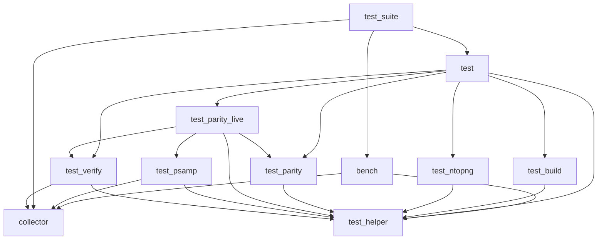

# tools/

Test, benchmark and collector tools for softflowd.  The Python scripts use the
standard library only and must be run from (or by the path of) this directory:
they import each other by module name.

## Entry points

| Script | What it does | Same as |
|---|---|---|
| `softflowd_test_suite.py` | One entry point for the three tools below; the first argument selects one. Without a subcommand it runs `compat`. | |
| `softflowd_test.py` | Backward compatibility and variants test suite: builds the C stable / development, C++ and Rust binaries, replays pcaps through two builds (A vs B) and compares the exported flows, the control socket replies, the PSAMP and ntopng exports, and the parity of softflowd+ with softflowd. Optionally measures the daemons (`--gauge-clock`, `--benchmark`, `--callgrind`, `--perf`). | `softflowd_test_suite.py compat` (alias `test`) |
| `softflowd_bench.py` | Export benchmark: compares the export build variants across pcaps and NetFlow/IPFIX versions with hyperfine (or a plain timing loop), perf and callgrind. | `softflowd_test_suite.py bench` |
| `softflowd_collector.py` | Flow collector: prints NetFlow v1/v5/v9 and IPFIX flows received on a UDP port as CSV with the column names of `nfdump -o csv`. The successor of `deprecated/collector.pl`. | `softflowd_test_suite.py collect` |

Each script takes the same options as the subcommand it corresponds to
(`softflowd_test.py -h`, `softflowd_test_suite.py compat -h` and so on).

`softflowd_test_suite.py` was `softflowd_test_collector.py`, which held all of
this in one file.  `softflowd_test.py` is its former `compat`,
`softflowd_bench.py` its former `bench` and `softflowd_collector.py` its former
`collect` (which was also its default; the default is now `compat`).

## Modules of the compat suite

These are imported by `softflowd_test.py`; they are not meant to be run.

| Module | Contents |
|---|---|
| `softflowd_test_helper.py` | Helpers shared by the compat suite and the bench (`run_command`, `build_c`, `perf_stat`, `callgrind_profile`, `parse_gauge`, ...), the sample pcaps, the output helpers, and the settings that `compat_main()` sets from the command line (see "Shared state"). |
| `softflowd_test_build.py` | Builds of the C stable / development, C++ and Rust binaries, with the binary cache. |
| `softflowd_test_verify.py` | The checks of the exported flows (collector output, CLI, control socket) and the measurements (`--gauge-clock`, `--benchmark`). |
| `softflowd_test_psamp.py` | PSAMP checks (`-v psamp` sender and `-R` receiver). Also used by `psamp_regress.py`. |
| `softflowd_test_ntopng.py` | ntopng checks (the ZMQ export of `-v ntopng`). |
| `softflowd_test_parity.py` | Parity checks, part 1: what softflowd+ (C++) must do byte for byte like softflowd (C), offline (exported datagrams, control replies, logs). |
| `softflowd_test_parity_live.py` | Parity checks, part 2: live capture, daemon, signals, CLI errors, and the comparison of a pair (`run_single_comparison`). |

## Steps of a pair comparison

`softflowd_test.py` compares pairs A vs B (A is the reference).  The steps that
are printed for a pair, and which pairs get them:

| Step | Check | Pairs |
|---|---|---|
| 1 | CLI options | all |
| 2 | control socket (`softflowctl`) | all (`--skip-ctl` skips it) |
| 3 | exported flows, decoded by nfdump or the built-in collector | all |
| 4 | measurement (`--gauge-clock`, `--benchmark`, `--callgrind`, `--perf`) | all, when one of these is on |
| 5 | PSAMP sender and receiver (`--skip-psamp` skips it) | the pairs of step 6, or `--psamp` |
| 6 | byte for byte: datagrams, control replies, logs, CLI errors, live capture (`--skip-parity` skips it) | `PARITY_PAIRS` in `softflowd_test_parity.py` (`softflowd-static` vs `softflowd`, `softflowd-direct` vs `softflowd`, `softflowd` vs `softflowd+`), or `--strict` |

`--skip-static` and `--skip-direct` leave out the `softflowd-static` and
`softflowd-direct` builds and their pairs.

## Dependencies

An arrow means "imports".  `softflowd_collector.py` and
`softflowd_test_helper.py` import no other file of this directory.



Node names are the file names without `softflowd_` and `.py` (`test` is
`softflowd_test.py`, `test_suite` is `softflowd_test_suite.py`).  The same as a
list:

| File | Imports |
|---|---|
| `softflowd_collector.py` | (none) |
| `softflowd_test_helper.py` | (none) |
| `softflowd_test_build.py` | helper |
| `softflowd_test_ntopng.py` | helper |
| `softflowd_test_parity.py` | helper |
| `softflowd_test_psamp.py` | collector, helper |
| `softflowd_test_verify.py` | collector, helper |
| `softflowd_test_parity_live.py` | helper, parity, psamp, verify |
| `softflowd_bench.py` | collector, helper |
| `softflowd_test.py` | build, helper, ntopng, parity, parity_live, verify |
| `softflowd_test_suite.py` | bench, collector, test |

The names in the right column are shortened in the same way.  There are no
import cycles.  `softflowd_test_verify.py`
holds the checks and the measurements together because they call each other.

### Shared state

`softflowd_test.py` (`compat_main()`) sets some settings from the command line
at run time: `SUITE_TMP_DIR`, `COLLECTOR_BACKEND`, `PCAP_DIR`, `CACHE_DIR`,
`REBUILD_STABLE`, `REBUILD_DEV`, `REFRESH_PCAP` and `COMPAT_PCAPS` live in
`softflowd_test_helper.py`; `MEASURE` and `BUILD_OPTIMIZED_FOR_MEASURE` live in
`softflowd_test_verify.py`.  Because they change after the import, every other
module reads and writes them through the module (`helper.SUITE_TMP_DIR`,
`verify.MEASURE`), never with `from ... import`: an imported copy would keep
the value that the name had at the import.

## Other files

| File | What it does |
|---|---|
| `psamp_regress.py` | PSAMP regression test of one build, or of two builds against each other, for `send_psamp()` and `recv_psamp()` in `psamp.c`. Imports `softflowd_test_psamp.py` (and through it the helper and the collector). |
| `gen_ci_smoke_pcap.py` | Generates a tiny deterministic pcap (IPv4 or IPv6). Run as a command (not imported) by the psamp, ntopng, parity and parity_live modules and by the CI. |
| `compare_expiry_stats.sh` | Compares the expiry statistics of the stable softflowd and of this tree on pcaps with a small flow table. |
| `check-bsd-compat.sh` | Compile check on Linux of what the OpenBSD job of the CI sees. |
| `deprecated/collector.pl` | The old Perl collector (NetFlow v1 and v5 only); use `softflowd_collector.py`. |
| `deprecated/benchmark_export.sh` | Wrapper of `softflowd_bench.py` for old command lines. |

## Usage

```
tools/softflowd_test.py [OPTIONS] [PCAP...]        # compat
tools/softflowd_test_suite.py [OPTIONS] [PCAP...]  # the same, compat is the default
tools/softflowd_test_suite.py test [OPTIONS]       # alias of compat
tools/softflowd_bench.py [OPTIONS] PCAP...
tools/softflowd_collector.py [-p PORT] [-b ADDR] [-6]
```

Run any of them with `-h` for the options.
